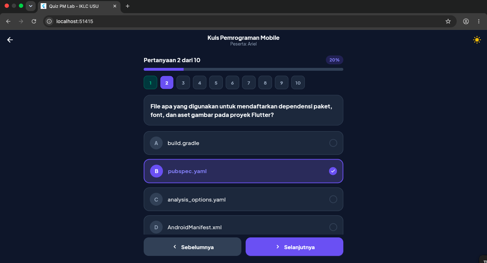

# PilihDong

Aplikasi kuis pilihan ganda seputar Web Programming, Flutter, iOS, dan Android.

<p align="center">
  
</p>

---

## Tentang Proyek Ini

PilihDong adalah aplikasi kuis interaktif yang dibuat untuk menguji pemahaman teknis seputar dunia pengembangan aplikasi modern. Alih-alih menghafal definisi teoretis yang kaku, materi di dalam aplikasi ini berfokus pada konsep dasar dan studi kasus yang lazim ditemui saat menulis kode sehari-hari.

Aplikasi ini dibangun menggunakan framework Flutter dengan arsitektur multiplatform, sehingga dapat dijalankan langsung di peramban Web, komputer desktop (macOS), maupun perangkat seluler (Android dan iOS).

---

## Topik Kuis yang Tersedia

Pengguna dapat memilih topik spesifik yang ingin diuji melalui pemilih kategori di halaman utama, atau memilih mode campuran untuk menjawab seluruh topik sekaligus:

1. Web Programming
   Membahas perataan Flexbox di CSS, perbedaan kesetaraan tipe di JavaScript (== vs ===), status code REST API (seperti 201 Created), cara kerja Event Loop dan Call Stack, serta penggunaan tag semantik HTML5.

2. Flutter dan Dart
   Membahas perbedaan StatelessWidget dan StatefulWidget, manajemen dependensi pada pubspec.yaml, cara kerja Hot Reload, manajemen state reaktif menggunakan Provider dan ChangeNotifier, serta null safety dengan kata kunci late.

3. iOS Development
   Membahas immutability di Swift (let vs var), pembuatan antarmuka deklaratif dengan SwiftUI, sistem manajemen memori Automatic Reference Counting (ARC), penggunaan property wrapper @State, serta penanganan tipe data Optional.

4. Android Native
   Membahas lifecycle Activity (termasuk onResume), toolkit antarmuka modern Jetpack Compose, penyimpanan state menggunakan ViewModel saat terjadi configuration change, deklarasi izin di AndroidManifest.xml, serta perbedaan val dan var di Kotlin.

5. Campur Aja (Semua Topik)
   Menyajikan 20 soal kombinasi dari seluruh topik di atas secara acak untuk tantangan menyeluruh.

---

## Tangkapan Layar

### Mode Terang (Light Mode)

| Halaman Awal | Input Nama dan Topik | Pengerjaan Kuis |
| :---: | :---: | :---: |
|  |  |  |

### Mode Gelap (Dark Mode)

| Pertanyaan Terjawab | Evaluasi Hasil dan Skor | Pembahasan dan Rincian Jawaban |
| :---: | :---: | :---: |
|  |  |  |

---

## Karakteristik dan Fitur Aplikasi

- Pemilih Kategori Dinamis: Pengguna dapat memilih kategori materi sebelum kuis dimulai. Jumlah soal dan bank pertanyaan akan menyesuaikan dengan kategori yang dipilih secara otomatis.
- State Tahan Rotasi: Manajemen state dipusatkan pada QuizProvider dengan pola ChangeNotifier. Progres pengerjaan, jawaban yang sudah dipilih, dan nomor pertanyaan tidak akan hilang saat orientasi perangkat diputar (portrait atau landscape).
- Bar Navigasi Pertanyaan Cepat: Pengguna dapat berpindah langsung ke nomor soal mana pun tanpa harus menekan tombol selanjutnya berulang kali.
- Pembahasan dan Rincian Jawaban: Setelah menyelesaikan kuis, pengguna dapat membuka accordion pembahasan untuk setiap butir soal guna melihat jawaban yang benar beserta penjelasan logisnya.
- Dukungan Dua Tema Tampilan: Tersedia tombol pengganti tema di pojok kanan atas untuk beralih antara tema terang dan tema gelap.
- Tata Letak Adaptif: Menggunakan kontainer pembatas lebar (AdaptiveContainer) agar tampilan antarmuka tetap simetris dan rapi saat dibuka pada layar lebar seperti tablet atau monitor komputer.

---

## Struktur Direktori

```text
lib/
├── constants/
│   ├── app_colors.dart         # Konfigurasi palet warna tema terang dan gelap
│   └── app_styles.dart         # Standar tipografi dan gaya teks
├── models/
│   └── question_model.dart     # Struktur data Question, Category, dan Bank Soal
├── providers/
│   ├── quiz_provider.dart      # Logika alur kuis, perhitungan skor, dan filter topik
│   └── theme_provider.dart     # Logika pergantian tema terang dan gelap
├── widgets/
│   ├── adaptive_container.dart # Pembatas lebar antarmuka untuk tablet dan web
│   ├── app_button.dart         # Komponen tombol reusable (primary, secondary, outline)
│   ├── option_card.dart        # Kartu opsi pilihan ganda interaktif
│   ├── progress_bar.dart       # Indikator progres pengerjaan soal
│   └── theme_toggle_button.dart# Tombol pengubah tema pada AppBar
├── screens/
│   ├── welcome_screen.dart     # Halaman input nama pengguna dan pemilihan topik
│   ├── quiz_screen.dart        # Halaman pengerjaan soal kuis dan navigasi chip
│   └── result_screen.dart      # Halaman hasil skor, evaluasi, dan pembahasan
└── main.dart                   # Titik masuk utama aplikasi (MultiProvider)
```

---

## Panduan Menjalankan di Komputer Lokal

### Prasyarat
- Flutter SDK versi 3.24.1 atau yang lebih baru
- Dart SDK versi 3.5.1 atau yang lebih baru
- Google Chrome (untuk menjalankan versi Web)

### 1. Memasang Dependensi
Jalankan perintah berikut di dalam direktori proyek:
```bash
flutter pub get
```

### 2. Menjalankan Aplikasi

Jalankan di peramban Web Google Chrome:
```bash
flutter run -d chrome
```

Jalankan di desktop macOS:
```bash
flutter run -d macos
```

Jalankan di emulator atau perangkat fisik Android:
```bash
flutter run -d android
```

---

## Verifikasi dan Pengujian

Untuk memastikan kualitas kode dan memverifikasi unit test serta widget test:

```bash
# Menjalankan static analyzer
flutter analyze

# Menjalankan automated test suite
flutter test
```

---

## Kredit dan Lisensi

- Ilustrasi: Storyset by Freepik
- Tipografi: Font Plus Jakarta Sans dan Poppins (Google Fonts / Open Font License)
- Ikonografi: Material Icons bawaan Flutter Framework
- Lisensi: Proyek ini dilisensikan di bawah lisensi MIT
