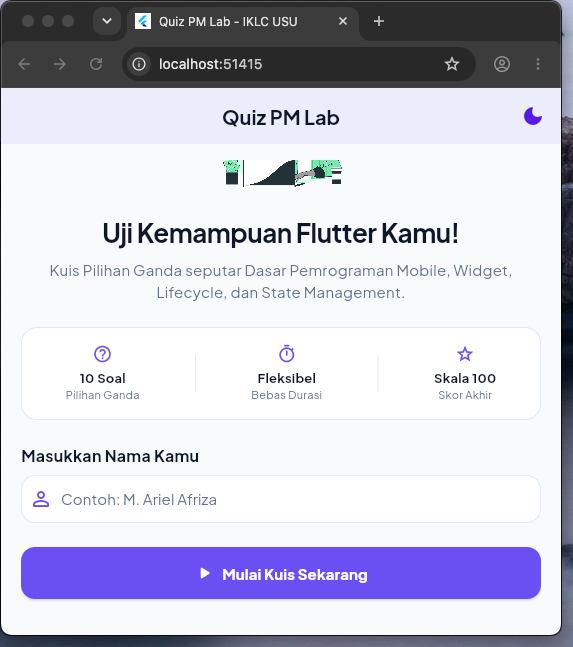
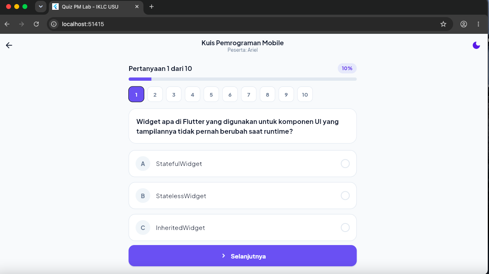
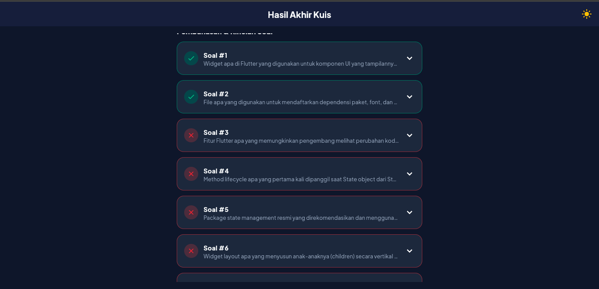

# 📱 PilihDong - Interactive Quiz App

<p align="center">
  
</p>

<p align="center">
  <strong>Aplikasi Kuis Pilihan Ganda Interaktif Modern Berbasis Flutter</strong>
</p>

<p align="center">
  
  
  
  
  
</p>

---

## 🌟 Tentang PilihDong

**PilihDong** adalah aplikasi kuis interaktif modern yang dibangun menggunakan Flutter Framework. Aplikasi ini dirancang untuk menguji pemahaman seputar konsep dasar **Pemrograman Mobile**, **Flutter Widget Hierarchy**, **Lifecycle**, **State Management**, dan **Bahasa Pemrograman Dart**.

Dengan mengusung desain yang bersih, minimalis, dan adaptif di berbagai ukuran layar (smartphone, tablet, maupun browser web), PilihDong menjamin pengalaman pengguna yang responsif, intuitif, dan tahan terhadap rotasi orientasi layar tanpa kehilangan progres kuis.

---

## 📸 Tangkapan Layar (Screenshots)

### 🌓 Mode Terang (Light Mode)
| 1. Halaman Awal | 2. Input Nama Pengguna | 3. Pengerjaan Soal |
| :---: | :---: | :---: |
|  |  |  |

### 🌙 Mode Gelap (Dark Mode)
| 4. Kuis Terjawab | 5. Hasil & Akurasi Skor | 6. Pembahasan & Rincian Soal |
| :---: | :---: | :---: |
|  |  |  |

---

## ✨ Fitur-Fitur Utama

- 👤 **Input & Validasi Nama Pengguna:**
  - Validasi reaktif sebelum kuis dimulai (mencegah input kosong atau kurang dari 2 karakter).
  - Nama pengguna tersimpan secara reaktif dan terhubung ke halaman hasil evaluasi.

- 🎯 **Kuis Interaktif Pilihan Ganda (10 Soal):**
  - Bank soal modular mencakup topik fundamental: `Stateless vs StatefulWidget`, `pubspec.yaml`, `Hot Reload`, `Lifecycle initState()`, `Provider`, `Column vs Row`, `SingleChildScrollView`, `Null Safety (late)`, `Scaffold`, dan `dispose()`.
  - Visual feedback instan pada opsi jawaban yang dipilih.

- ⚡ **Quick Question Navigation Chips:**
  - Bar navigasi nomor soal yang memungkinkan pengguna melompat ke nomor soal mana pun secara instan.
  - Indikator status warna real-time untuk nomor soal yang sudah atau belum dijawab.

- 🔄 **State Management Tahan Rotasi (Provider & ChangeNotifier):**
  - Seluruh status pengerjaan kuis, opsi jawaban yang dipilih, indeks soal, dan skor **tidak akan ter-reset** saat layar perangkat dirotasi (portrait/landscape) atau berpindah antarhalaman.

- 📊 **Kalkulasi Skor Real-Time & Pembahasan Edukatif (Review Accordion):**
  - Kalkulasi otomatis skala 0 - 100 dengan metrik: *Jumlah Benar*, *Jumlah Salah*, dan *Akurasi (%)*.
  - Accordion interaktif yang menampilkan kunci jawaban benar disertai pembahasan edukatif lengkap untuk setiap butir soal.

- 🌗 **Dual Theme (Light & Dark Mode):**
  - Switch tema instan melalui tombol toggle animasi di AppBar.
  - Palet warna kontras yang ramah mata di berbagai kondisi pencahayaan.

- 📱 **Adaptive & Responsive Layout:**
  - Komponen `AdaptiveContainer` dengan `BoxConstraints` menjaga lebar tampilan optimal di tablet dan desktop browser agar tidak mengalami *pixel overflow*.

---

## 🏗️ Struktur Arsitektur Proyek

```text
lib/
├── constants/
│   ├── app_colors.dart         # Sistem palet warna Light & Dark mode
│   └── app_styles.dart         # Tipografi & style teks (Plus Jakarta Sans)
├── models/
│   └── question_model.dart     # Model Question data & Bank Soal Kuis
├── providers/
│   ├── quiz_provider.dart      # Business logic & state manajemen kuis
│   └── theme_provider.dart     # State manajemen tema Light / Dark mode
├── widgets/
│   ├── adaptive_container.dart # Wrapper pembatas layout responsif (mobile/tablet/web)
│   ├── app_button.dart         # Komponen tombol reusable (primary, outline, secondary)
│   ├── option_card.dart        # Kartu opsi jawaban dengan highlight interaktif
│   ├── progress_bar.dart       # Bar indikator progres kuis
│   └── theme_toggle_button.dart# Tombol toggle switch tema terang/gelap
├── screens/
│   ├── welcome_screen.dart     # Layar awal sambutan & input nama pengguna
│   ├── quiz_screen.dart        # Layar pengerjaan kuis & navigasi pertanyaan
│   └── result_screen.dart      # Layar hasil skor, evaluasi & review accordion
└── main.dart                   # Root MultiProvider & entry point aplikasi
```

---

## 🚀 Panduan Menjalankan di Komputer Lokal

### 1. Prasyarat Sistem
- **Flutter SDK**: `^3.24.1` (atau versi stabil terbaru)
- **Dart SDK**: `^3.5.1`
- **Google Chrome** (untuk menjalankan versi Web)

### 2. Kloning & Pemasangan Dependensi
```bash
# Unduh semua paket dependensi
flutter pub get
```

### 3. Menjalankan Aplikasi

- **Jalankan di Web (Google Chrome):**
  ```bash
  flutter run -d chrome
  ```

- **Jalankan di macOS Desktop:**
  ```bash
  flutter run -d macos
  ```

- **Jalankan di Android (Device / Emulator):**
  ```bash
  flutter run -d android
  ```

---

## 🧪 Pengujian & Analisis Kode

Jalankan test suite untuk memastikan semua komponen berfungsi dengan baik:
```bash
# Menjalankan static analyzer
flutter analyze

# Menjalankan automated widget smoke test
flutter test
```

---

## 🎨 Kredit Aset
- **Ilustrasi Vektor:** [Storyset by Freepik](https://storyset.com/) (`online_test.png` dan `questions.png`).
- **Font Kustom:**
  - [Plus Jakarta Sans](https://fonts.google.com/specimen/Plus+Jakarta+Sans) oleh Tokotype (SIL Open Font License).
  - [Poppins](https://fonts.google.com/specimen/Poppins) oleh Indian Type Foundry (SIL Open Font License).
- **Ikon:** Material Icons bawaan Flutter Framework.
