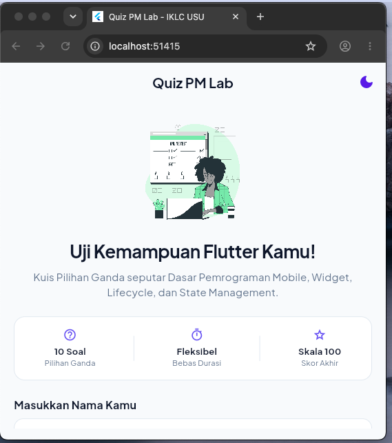
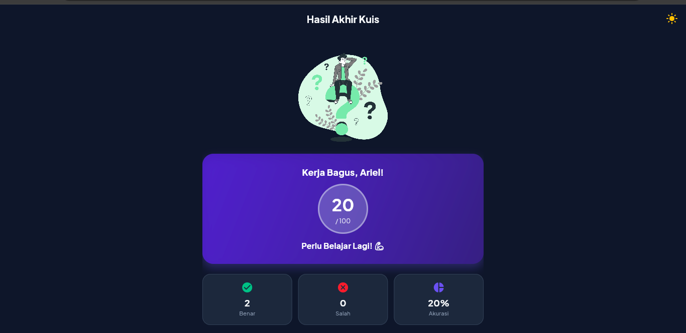

# 📱 PilihDong - Kuis Dev Santai & Interaktif

<p align="center">
  
</p>

<p align="center">
  <strong>Tempat Asik Buat Ngetes Seberapa Jago Lo di Dunia Coding!</strong><br/>
  <em>Tebak-tebakan pilihan ganda seputar Web, Flutter, iOS, sampe Android Native tanpa ribet.</em>
</p>

<p align="center">
  
  
  
  
  
</p>

---

## ☕ Cerita Singkat PilihDong

Bosen sama kuis coding yang isinya definisi teori kaku ala text-book kampus zaman purba? **PilihDong** dibuat buat lo yang pengen seru-seruan ngetes pemahaman teknis sehari-hari tanpa bikin pusing. 

Lo tinggal masukin nama panggilan, pilih topik yang lo kuasai (atau pilih mode *Campur Aja* kalau lagi berani), dan langsung gas ngerjain soalnya. Gak ada timer yang bikin panik, layoutnya enak dipandang di HP maupun browser, dan yang paling penting: **tiap soal ada pembahasan santai** biar lo gak bengong pas salah milih jawaban!

---

## 🎯 4 Topik Utama (+ Mode Campur)

Pilih topik yang lo suka lewat **Category Selector** di halaman depan:

1. 🌐 **Web Programming:**
   - Bedah konsep seputar Flexbox layout, JavaScript strict equality (`===`), REST API status codes, Event Loop, dan semantic HTML5.
2. 💙 **Flutter & Dart:**
   - Pertanyaan seputar StatelessWidget vs StatefulWidget, `pubspec.yaml`, Hot Reload vs Hot Restart, Provider & `ChangeNotifier`, serta null safety (`late`).
3. 🍎 **iOS Development:**
   - Eksplorasi Swift immutability (`let` vs `var`), SwiftUI property wrappers (`@State`), Automatic Reference Counting (ARC), dan Swift Optionals (`?`).
4. 🤖 **Android Native:**
   - Kupas tuntas Activity Lifecycle (`onResume`), Jetpack Compose, ViewModel configuration changes, `AndroidManifest.xml`, dan Kotlin `val` vs `var`.
5. 🎲 **Campur Aja (All-Stars Challenge):**
   - Tantangan maraton 20 soal kombinasi dari semua topik di atas!

---

## 📸 Intip Tampilan Aplikasinya

### 🌓 Mode Terang (Light Mode)
| Halaman Awal & Pilih Topik | Form Input Nama Santai | Pengerjaan Kuis Interaktif |
| :---: | :---: | :---: |
|  |  |  |

### 🌙 Mode Gelap (Dark Mode)
| Kuis Terjawab & Chip Soal | Evaluasi Skor & Akurasi | Review & Pembahasan Jawaban |
| :---: | :---: | :---: |
|  |  |  |

---

## ✨ Fitur-Fitur Asik di PilihDong

- 🗂️ **Category Selector Interaktif:**
  - Pilih kartu topik favorit lo dengan satu ketukan. Tiap kategori punya warna aksen dan ikon tersendiri.
- 🔄 **Anti-Reset Pas Layar Dirotasi (State Management Provider):**
  - HP lo gak sengaja muter landscape/portrait? Santai, jawaban dan nomor soal lo gak bakal ke-reset karena di-handle rapi pake `QuizProvider`.
- ⚡ **Quick Navigation Chips:**
  - Pengen loncat ke nomor 5 dulu terus balik ke nomor 1? Tinggal klik nomor chip di atas kartu pertanyaan.
- 💡 **Accordion Pembahasan Edukatif:**
  - Begitu kuis selesai, lo bisa buka rincian tiap butir soal buat baca kenapa jawaban lo bener atau salah.
- 🌗 **Dual Theme (Light & Dark Mode):**
  - Buat yang matanya cepet pegel, tinggal klik tombol saklar tema di pojok kanan atas buat pindah ke Dark Mode yang adem.
- 📱 **Responsif di Semua Ukuran Layar:**
  - Dibangun pake `AdaptiveContainer` biar pas dibuka di layar tablet atau monitor browser gak bakal melar aneh-aneh.

---

## 🏗️ Struktur Folder Proyek

```text
lib/
├── constants/
│   ├── app_colors.dart         # Palet warna Light & Dark mode
│   └── app_styles.dart         # Tipografi Plus Jakarta Sans
├── models/
│   └── question_model.dart     # Model Question, Category, & 20 Bank Soal
├── providers/
│   ├── quiz_provider.dart      # State manajemen kuis (jawaban, skor, filter topik)
│   └── theme_provider.dart     # State manajemen tema Light/Dark
├── widgets/
│   ├── adaptive_container.dart # Kontainer responsif anti-overflow
│   ├── app_button.dart         # Tombol reusable serbaguna
│   ├── option_card.dart        # Kartu opsi pilihan ganda
│   ├── progress_bar.dart       # Bar indikator progres kuis
│   └── theme_toggle_button.dart# Tombol saklar tema gelap/terang
├── screens/
│   ├── welcome_screen.dart     # Halaman sambutan, input nama & pilih topik
│   ├── quiz_screen.dart        # Halaman kuis dengan badge topik & navigasi
│   └── result_screen.dart      # Halaman skor, evaluasi & review pembahasan
└── main.dart                   # Entry point aplikasi PilihDong
```

---

## 🚀 Cara Menjalankan di Komputer Lokal

### 1. Unduh Dependensi
```bash
flutter pub get
```

### 2. Jalankan Langsung di Web (Google Chrome)
Paling cepet dan gak ribet:
```bash
flutter run -d chrome
```

### 3. Jalankan di macOS Desktop
```bash
flutter run -d macos
```

### 4. Jalankan di Android (Device / Emulator)
```bash
flutter run -d android
```

---

## 🧪 Pengujian Kode

```bash
# Cek static analysis (0 warnings & 0 errors)
flutter analyze

# Jalankan automated tests (Unit & Widget)
flutter test
```

---

## 🎨 Kredit Aset
- **Ilustrasi:** Storyset by Freepik
- **Font Kustom:** Plus Jakarta Sans & Poppins (Google Fonts / OFL)
- **Ikon:** Material Icons bawaan Flutter
